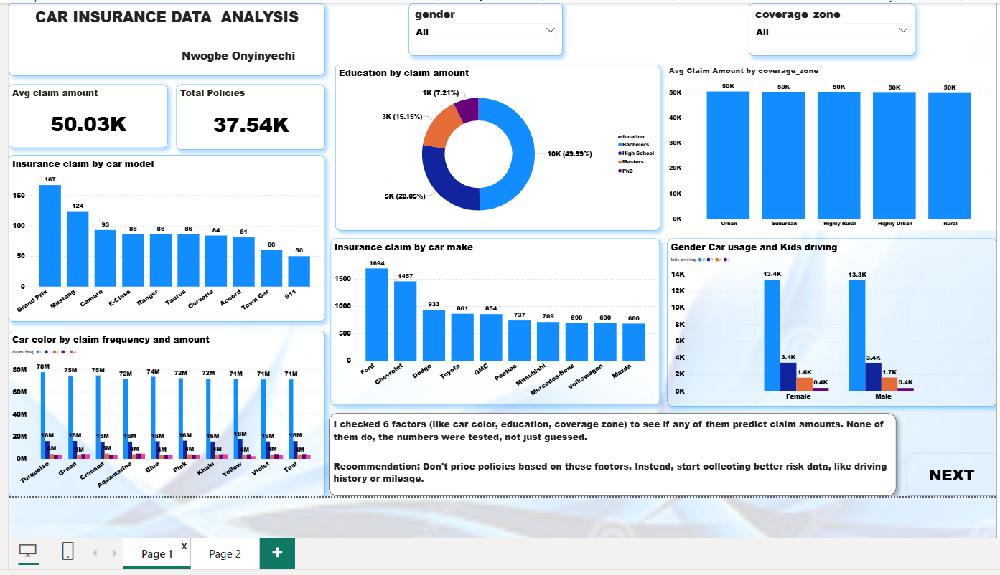
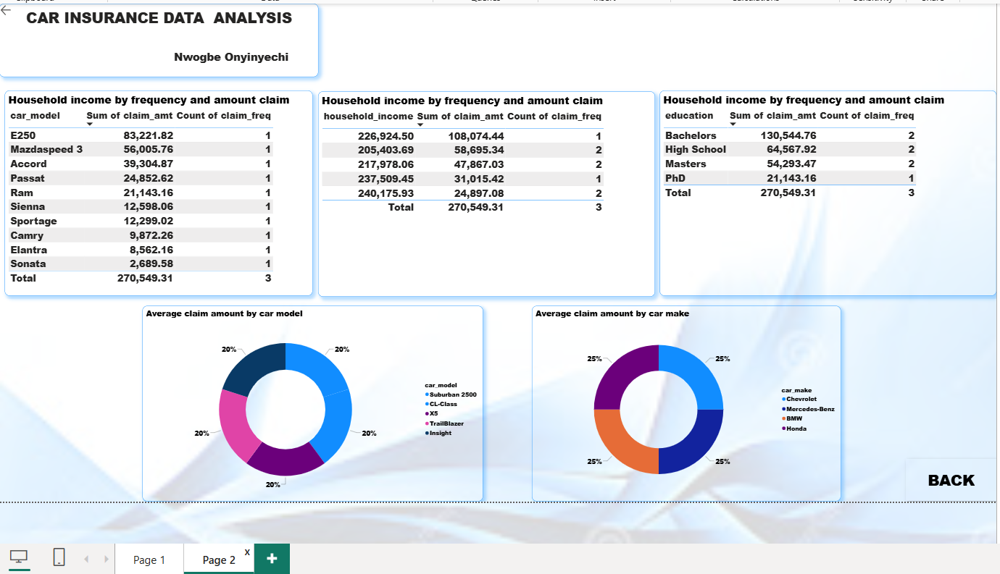

# Car Insurance — Risk Segmentation

> Do customer and vehicle attributes predict insurance claims? A statistically tested analysis of 37,542 policies using **PostgreSQL, Python, Excel and Power BI**, with an honest and important result: *none of the six variables tested predict claims.*

---

## 1. Introduction

Insurers often set prices using attributes such as where a customer lives, their marital status, education or even car colour. But if those attributes don't actually predict claims, pricing on them is unfair and adds no accuracy.

This project analyses **37,542 car insurance policies** to test whether six commonly assumed risk variables relate to the amount customers claim. I used formal statistical tests instead of eyeballing averages, and the result is a confirmed **null finding**: the current data does not support risk-based pricing on any of these variables. A null result is a real finding, because it stops the business from acting on a pattern that isn't there.

---

## 2. Problem Statement

The business wants to know **which customer or vehicle attributes predict insurance claims**, so it can decide whether they should inform pricing and underwriting.

**Questions this project answers:**
1. Does claim amount differ by coverage zone, marital status, education, car colour, gender or car use?
2. Do household income or vehicle year relate to claims?
3. Are any apparent differences real, or just random noise from small samples?
4. Should the business price or underwrite on these variables?

---

## 3. Data Sourcing

- **Dataset:** one table of **37,542 policies** (one row per policy) with 16 columns.
- **Source:** [add where the dataset came from, e.g. the training provider or platform]
- **Formats used:** CSV (`Car_Insurance.csv`) and Excel (`Car_Insurance.xlsx`).

| Group | Columns |
|---|---|
| Policy | `ID`, `coverage_zone`, `car_use` (private / commercial) |
| Customer | `birthdate`, `marital_status`, `gender`, `education`, `parent`, `kids_driving`, `household_income` |
| Vehicle | `car_make`, `car_model`, `car_color`, `car_year` |
| Claims (target) | `claim_amt` (claim amount), `claim_freq` (number of claims) |

---

## 4. Tools and What I Used Each For

| Tool | What I used it for |
|---|---|
| **PostgreSQL (pgAdmin)** | Created the table, loaded the data, and aggregated claims by every tested segment. Applied a minimum-sample-size filter (`HAVING COUNT(*) >= 30`) to car make |
| **Python (pandas, SciPy)** | Ran the formal statistical tests: one-way ANOVA and Pearson correlation with p-values, to confirm the null result |
| **Excel** | Formula-driven segment summaries (`AVERAGEIF`, `COUNTIF`, `SUMPRODUCT`), a car-make sample-size table, and a tightly scaled chart that makes the "no real difference" result visible |
| **Power BI (DAX)** | Built the interactive dashboard, with measures for average claim amount and spread vs the overall average, and a reliable-sample filter |

---

## 5. Data Transformation and Cleaning

**Checks I ran:**
- **No missing values** in any of the 16 columns, and **no fully duplicated rows**.
- **Duplicate ID found.** The ID `56-5402470` appears **twice**, with different birthdates, claim amounts and household incomes. These are two different policies that share an ID, not an accidental duplicate row. The import into PostgreSQL first failed with a "duplicate key" error because of this.
- **Range checks** on the numeric columns (claim amount, household income, vehicle year, claim frequency, kids driving).

**What I did:**
- Did **not** declare `ID` as a primary key, since it isn't unique in the source. I treated it as a label, not an identifier, and documented the reason in the SQL file. Both records were kept, because they are genuine, different policies.
- Set correct data types (dates, integers, decimals) when creating the table.
- **Enforced a minimum sample size of 30 policies** before reporting any car-make average. The first pass showed the biggest apparent differences sitting on samples of 2–10 policies. Those gaps were noise, not signal.
- Grouped household income into bands in SQL, because a correlation can't be calculated in plain SQL. The actual correlation was calculated in Python.

---

## 6. Analytics and Measures

### Statistical tests (Python)

| Variable | Test | Result | Verdict |
|---|---|---|---|
| Coverage zone | One-way ANOVA | F = 0.51, p = 0.728 | Not significant |
| Marital status | One-way ANOVA | F = 1.33, p = 0.263 | Not significant |
| Education | One-way ANOVA | F = 1.47, p = 0.220 | Not significant |
| Car colour | One-way ANOVA | F = 0.86, p = 0.625 | Not significant |
| Gender | One-way ANOVA | F = 1.30, p = 0.255 | Not significant |
| Car use | One-way ANOVA | F = 0.01, p = 0.938 | Not significant |
| Household income | Pearson correlation | r = −0.005, p = 0.364 | No relationship |
| Vehicle year | Pearson correlation | r = +0.001, p = 0.816 | No relationship |

**Other key numbers:**
- Overall average claim amount: **₦50,028.51**
- Car colour had the widest gap, only **5.55%** from the overall average, and still not significant.
- One car make initially looked high (₦79,049 average claim) but had only **3 policies**. With the 30-policy minimum, the range across reliable makes narrows to ₦45,419–₦56,268, consistent with no real effect.

### SQL (PostgreSQL)
- Average claim amount and frequency by coverage zone, marital status, education, gender and car colour (`GROUP BY`).
- Car-use distribution by gender and kids driving, using a window function: `SUM(COUNT(*)) OVER (PARTITION BY ...)`.
- Car-make averages with `HAVING COUNT(*) >= 30`.
- Income bands with `CASE WHEN`.

### Power BI (DAX measures)
```DAX
Avg Claim Amount = AVERAGE('Insurance Policies'[claim_amt])

Claim Amount Spread % of Average =
VAR CurrentAvg = CALCULATE([Avg Claim Amount])
VAR OverallAvg = CALCULATE([Avg Claim Amount], ALL('Insurance Policies'))
RETURN DIVIDE(CurrentAvg - OverallAvg, OverallAvg)

Reliable Segment Count =
VAR MinSampleSize = 30
RETURN
    CALCULATE(
        COUNTROWS('Insurance Policies'),
        FILTER(
            VALUES('Insurance Policies'[car_make]),
            CALCULATE(COUNTROWS('Insurance Policies')) >= MinSampleSize
        )
    )
```

---

## 7. Dashboard and Visuals

The Power BI dashboard has two pages. Page 1 is the main view and carries the headline finding; Page 2 gives supporting detail. The NEXT and BACK buttons move between them.

### Page 1: Claims Overview and Key Finding



- **Headline cards:** average claim amount (about 50K) and the total number of policies analysed (37,542).
- **Slicers:** gender and coverage zone, so every visual on the page can be filtered.
- **Claims by car model and by car make:** bar charts showing which vehicles appear most often in claims.
- **Education by claim amount:** a donut chart of claims split by education level.
- **Average claim amount by coverage zone:** compares coverage zones. Averages are almost identical across zones.
- **Car colour by claim frequency and amount:** claims across car colours are nearly flat, matching the statistical result.
- **Gender, car usage and kids driving:** the split of policies by gender and number of kids driving.
- **Key finding box:** a plain-language summary: six factors were tested, none predict claim amounts, and the recommendation is not to price on them and to collect better risk data instead.

### Page 2: Claim Detail by Vehicle, Income and Education



- **Detail tables:** the average claim amount and the number of policies, broken down by car model, household income band and education. Household income is grouped into five bands (under 50K, 50K-100K, 100K-150K, 150K-200K and 200K+) because almost every household has a different exact income. The average claim stays at about 50K in every band, which matches the statistical result.
- **Average claim amount by car model and by car make:** donut charts comparing how evenly claims are spread.

---

## 8. Recommendation

1. **Do not build a pricing or underwriting model on these six variables.** Formal testing confirms that none of them separate high-risk from low-risk policyholders.
2. **Ask data engineering to capture real risk data** before attempting any segmentation or pricing model: driving record, annual mileage, prior at-fault claims and a credit-based insurance score.
3. **Keep pricing flat across these attributes for now.** Charging different rates on differences the data doesn't support risks regulatory and fairness problems with no gain in accuracy.

**Validate before acting:** if new variables are added, re-run the same ANOVA and correlation tests instead of assuming they will perform better. Keep the 30-policy minimum on any future car-make or car-model analysis.

---

## 9. Conclusions

- **None of the six variables predict claim amount.** Every ANOVA returned p > 0.05, and the correlations for household income and vehicle year are effectively zero.
- **A "pattern" can come from a small sample.** The car make that looked 58% above average had only 3 policies. A minimum sample size removed the false signal.
- **Why there is no signal:** the dataset records demographic and cosmetic attributes, not the real drivers of claims (driving behaviour and exposure). The absence of a pattern reflects what the data measures, not an error in the analysis.
- **Value of a null result:** it protects the business from pricing on attributes that don't matter, and it gives a baseline that any future risk model must beat.

---

*Prepared by Nwogbe Onyinyechi Victoria · Data Analyst*
